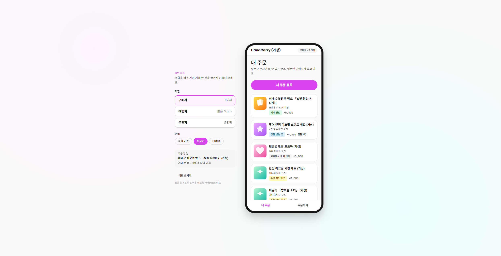

# 임종훈 · 핸드캐리 중개 (HandCarry, 가칭)

일본인 여행자가 일본 한정 굿즈를 사서 서울로 들고 오고, 한국 구매자가 에스크로로 결제하는 핸드캐리 중개 서비스입니다. 여행자는 상품값과 보상금을 원화로 받아 여행 경비로 씁니다.

아이디어 목록의 **3. 핸드캐리 중개 (엔저 활용)** 에 해당합니다. 백엔드 없이 브라우저 안에서만 동작하는 시연용 프로토타입이며, 결제·인증·번역은 모두 가짜(mock)입니다.

## 데모

**https://handcarry-prototype.vercel.app/buyer**

[](https://handcarry-prototype.vercel.app/buyer)

너비 1024px 이상의 창으로 열면 왼쪽 시연 패널에서 구매자·여행자·운영자 역할과 언어(한국어·일본어)를 바꿀 수 있습니다. `데모 초기화`를 누르면 처음 상태로 돌아갑니다.

## 폴더

| 경로 | 내용 |
|---|---|
| [`handcarry/`](handcarry) | 프로토타입 전체 코드 |
| [`handcarry/PRD.md`](handcarry/PRD.md) | 제품 요구사항 |
| [`handcarry/DEMO.md`](handcarry/DEMO.md) | 5분 시연 대본과 예상 질문 |
| [`handcarry/DESIGN.md`](handcarry/DESIGN.md) | 디자인 시스템 |
| [`엔저_핸드캐리.pdf`](엔저_핸드캐리.pdf) | 서비스 제안 발표 자료 |

## 기술 스택

Next.js 16 (App Router) · React 19 · TypeScript · Tailwind CSS 4 · Vitest · Playwright

## 로컬에서 실행하기

```bash
cd idea/jonghoon/handcarry
npm install
npm run build
npm run start   # http://localhost:3000
```
