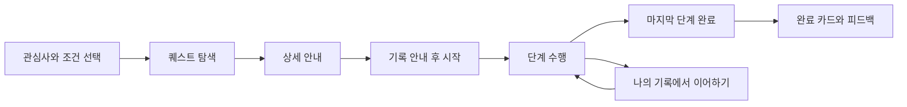
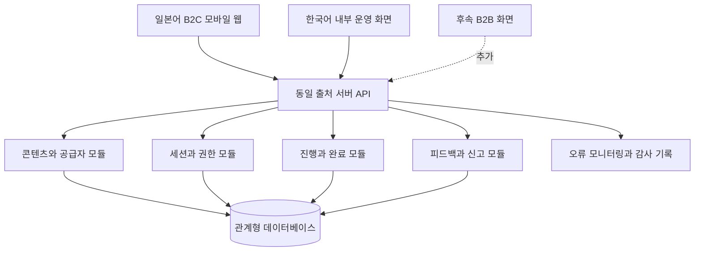

# 서울 경험 서비스 B2C 구현 설계 초안

문서 버전: 0.1 · 작성일: 2026-11-21 · 상태: 구현 기준 초안

서울에 있는 일본인이 혼자서도 새로운 로컬 경험을 발견하고 실행할 수 있도록 돕는 B2C 모바일 웹을 먼저 구현한다. 사용자는 일본어 안내로 자율형 퀘스트를 탐색하고, 단계별로 수행하고, 완료 기록을 남긴다. 공급자·콘텐츠·이용 기록을 분리해 이후 업체용 운영 기능을 추가할 수 있도록 한다.

이 문서는 제품 범위, 화면, 상태 전이, 데이터, API, 운영 품질과 검수 기준을 정의한다. 아래의 ‘채택’은 현재 구현 기준이며 사용자 검증이 끝났다는 뜻은 아니다. 개발 도중 범위를 바꾸면 결정 기록과 관련 API·완료 기준을 함께 갱신한다.

# 제품 목표와 결정 상태

| 구분 | 내용 | 상태 |
| --- | --- | --- |
| 주제 | 서울에 있는 일본인에게 편리함·즐거움·성취감을 제공 | 대화에서 제공된 행사 안내 기준 |
| 개발 순서 | B2C 먼저 구현하고 B2B는 요구가 확인되는 순서대로 추가 | 사용자 확정 |
| 첫 제품 | 일본어 안내를 제공하는 자율형 로컬 퀘스트 모바일 웹 | 현재 구현 기준 |
| 첫 타깃 | 서울에서 혼자 새로운 경험을 찾는 일본인, 특히 재방문 관광객 | 검증할 가설 |
| 사용 방식 | 가입 없이 탐색하고, 시작·신고 시 익명 브라우저 세션으로 기록 | 설계 채택 |
| 공급 방식 | 내부 운영자가 확인한 콘텐츠를 직접 등록·공개 | 설계 채택 |
| 확장 방향 | 공급자가 자기 콘텐츠와 참가자를 관리하는 B2B2C | 후속 요구에 따라 확장 |
| 기술 선택 | Next.js·TypeScript·PostgreSQL 작업 기준, 외부 서비스는 프로비저닝 전 후보 | 기술 결정 v0.1 |

핵심 사용자 문장: “새로운 곳에 가보고 싶은데 혼자 가도 되는지, 무엇을 어떻게 해야 하는지 모르겠다.”

가치 가설: 장소 정보에 혼자 이용하는 방법과 일본어 행동 안내를 함께 제공하면 사용자가 새로운 경험을 시작하기 쉬워진다. 완료 기록은 성취감을 제공한다. 관광객과 거주자를 모두 만족시켜야 한다는 전제는 두지 않는다.

# 사용자 검증과 성공 기준

인터뷰에서는 최근 실제 사건, 원래 하려던 행동, 기존 해결 방법, 남은 불편, 예상보다 기뻤던 경험을 확인한다. 인터뷰 한 사람의 의견은 그 사람의 사례로 기록하고 전체 일본인의 수요로 일반화하지 않는다.

| 검증 질문 | 확인할 증거 |
| --- | --- |
| 낯선 장소를 피하는 이유가 안내 부족인가 | 최근 포기한 방문 사례와 이유 |
| 혼자 이용 가능 정보가 결정에 도움이 되는가 | 안내 전후의 선택 변화와 본인 설명 |
| 단계 안내가 실제 행동을 돕는가 | 도움 없이 다음 행동을 이해하는지 관찰 |
| 완료 기록이 기쁨을 주는가 | 완료 화면 반응과 다시 보고 싶은 이유 |
| 사용자가 새로운 경험을 했는가 | 수행 후 본인의 구체적인 설명 |

초기 사용자 테스트는 일본어 사용자 3~5명을 목표로 한다. 이는 모집 목표이며 통계적 대표성을 의미하지 않는다. 화면 테스트와 실제 현장 체험은 별도로 기록한다. 실내 시연의 완료 입력은 현장 경험 검증으로 계산하지 않는다.

모집 기준, 비유도 질문, 인터뷰 기록, 첫 지역·퀘스트 선택 기준은 [일본인 사용자 검증 계획 v0.1](USER_RESEARCH_v0.1.md)을 따른다.

출시 검수 목표는 도움 없이 탐색부터 진행 화면까지 도달하는 것, 진행 상태가 새로고침 후 유지되는 것, 완료 기록이 중복되지 않는 것이다. 만족도와 실제 방문 의향은 응답 수와 함께 보고하며 출시 전 달성한 성과로 미리 표현하지 않는다.

# 구현 범위와 우선순위

P0는 첫 시연·배포에 필요한 필수 범위다. P1은 P0 검수가 끝난 뒤 추가한다.

| ID | 우선순위 | 기능 | 범위 |
| --- | --- | --- | --- |
| FR01 | P0 | 탐색 | 지역·관심사·최대 소요 시간 조건으로 목록과 추천 이유 제공 |
| FR02 | P0 | 상세 안내 | 할 일, 예상 시간·비용, 혼자 이용 조건, 정보 확인일 |
| FR03 | P0 | 익명 기록 | 시작·신고 시 브라우저 전용 세션 생성, 기록 안내·삭제 제공 |
| FR04 | P0 | 진행 | 순서대로 단계 완료, 중단 후 이어하기 |
| FR05 | P0 | 완료 | 완료 카드와 개인 기록, 중복 완료 방지 |
| FR06 | P0 | 피드백 | 완료 후 기쁨 점수와 선택 의견 |
| FR07 | P0 | 정보 오류 신고 | 상세·진행 화면에서 잘못된 정보 접수 |
| FR08 | P0 | 내부 운영 | 콘텐츠 초안·검수·공개·일시 중지·보관 |
| FR09 | P0 | 운영 품질 | 권한·입력 검증·오류 복구·감사 로그·백업 |
| FR10 | P1 | 즐겨찾기 | 시작 전 저장과 목록 |
| FR11 | P1 | 이미지 내보내기 | 완료 카드를 기기 이미지로 저장 |
| FR12 | P1 | 계정 연결 | 기존 익명 기록을 계정에 연결, 기기 간 동기화 |

첫 범위에 포함하지 않는 기능은 예약·결제·정산·호스트 모집·채팅·리뷰 커뮤니티·현금성 보상·GPS 인증·실시간 영업 보장·AI 자동 일정 생성이다. 이 기능들은 별도 요구와 상태 모델을 정의한 뒤 추가한다.

첫 콘텐츠 목표는 선정한 지역 1곳, 퀘스트 6개, 퀘스트당 3~5단계다. 현장 검증이나 일본어 검수가 부족하면 개수를 줄이고, 검증되지 않은 내용을 실제 이용 가능한 콘텐츠처럼 공개하지 않는다.

# 사용자 흐름과 상태 전이



목록과 상세는 세션 없이 열람할 수 있다. 시작 버튼을 누르면 “진행 기록은 이 브라우저에 저장되며 다른 기기와 공유되지 않습니다”를 일본어로 안내한 뒤 세션을 만든다. 상세 화면에서 처음 오류 신고를 할 때도 세션·보존 안내를 제공하고 세션을 만든다. 이미 세션이 있으면 재사용한다.

진행 상태는 in_progress, completed 두 가지다. 나가기는 진행 상태를 보존하며, 별도 실패·포기 상태는 첫 버전에 두지 않는다. 완료한 퀘스트는 기록을 다시 열며 반복 수행은 후속 기능이다.

단계는 미완료에서 완료로만 바뀐다. 앞 단계 완료 후 다음 단계를 완료할 수 있으며, 완료한 단계의 안내는 다시 볼 수 있다. 마지막 단계 완료와 전체 완료 처리는 같은 트랜잭션에서 수행한다.

콘텐츠 상태는 draft → published → paused → published 또는 archived다. draft에서 archived로 보관할 수 있고 published에서 archived로 종료할 수 있다. archived는 종료 상태이며 재개하려면 새 퀘스트를 만든다. paused 상태에는 공개 가능한 일본어 중지 사유가 필요하다.

published만 신규 탐색 목록에 노출한다. paused·archived는 신규 시작을 차단한다. 기존 진행과 완료 기록은 읽을 수 있지만 미완료 기록의 단계 완료는 차단한다. paused가 published로 복구되면 기존 진행을 이어갈 수 있다.

# 화면 명세

| 화면 | 경로 | 주요 내용과 행동 |
| --- | --- | --- |
| 시작 | / | 일본어 소개, 지역·관심사·시간 선택, 목록 진입 |
| 탐색 | /quests | 조건 변경, 퀘스트 카드, 추천 이유, 더 보기 |
| 상세 | /quests/:questId | 단계 개요, 비용·시간·혼자 이용 조건, 시작·이어하기·기록 보기 |
| 진행 | /runs/:runId | 현재 단계, 방문 안내, 지도 연결, 한국어 요청 카드, 단계 완료 |
| 완료 | /runs/:runId/completion | 완료 카드, 기쁨 점수, 선택 의견 |
| 나의 기록 | /my | 진행 중·완료 목록, 기록 보존 안내, 전체 기록 삭제 |
| 운영 목록 | /admin/quests | 초안·공개·중지·보관 필터와 오류 신고 |
| 운영 편집 | /admin/quests/:questId | 콘텐츠 편집, 일본어 검수 표시, 공개 미리보기, 공개·중지 |

사용자 화면의 표시 언어는 일본어, 운영 화면은 한국어를 기본으로 한다. 한국어 요청 카드는 사용자가 직원에게 보여주는 한국어 원문과 사용자가 이해할 일본어 뜻을 함께 제공한다.

탐색 카드에는 제목, 지역, 예상 소요 시간, 비용 범위 또는 비용 미확인, 혼자 이용 조건, 조건과 맞는 이유를 표시한다. 기본 조건은 지역 전체·관심사 전체·시간 제한 없음이다. 관심사 선택은 필수가 아니다.

진행 화면의 완료 버튼은 자신이 해당 행동을 마쳤음을 표시하는 자기 확인이다. 사진·위치 인증이나 보상 지급을 의미하지 않는다. 오조작 방지를 위해 완료할 행동을 버튼 주변에 명확하게 표시한다.

완료 카드는 퀘스트 제목·완료 날짜·획득한 스탬프를 보여주는 화면 구성이다. P0에서는 공개 공유 URL이나 이미지 파일 생성 없이 서버 기록에서 재구성한다.

| 공통 상태 | 화면 동작 |
| --- | --- |
| 로딩 | 주요 레이아웃 유지, 중복 제출 방지, 완료 여부를 추측해 표시하지 않음 |
| 결과 없음 | 적용 조건과 조건 해제 버튼 표시, 자동으로 조건을 바꾸지 않음 |
| 네트워크 오류 | 입력·현재 화면 유지, 재시도 제공 |
| 세션 만료 | 기록 접근 불가 안내, 새 기록 시작 선택, 과거 기록 복구를 약속하지 않음 |
| 콘텐츠 중지 | 일본어 사유와 탐색으로 돌아가기 표시, 완료 버튼 비활성화 |
| 존재하지 않거나 접근 불가 | 동일한 찾을 수 없음 화면 |
| 요청 중 응답 유실 | 서버에서 현재 상태를 조회한 뒤 재시도 여부 결정 |

지도 연결 실패 시 한국어 주소 복사를 제공한다. 위치 권한이 없어도 지역 선택과 주소 기반 이용이 가능해야 한다.

# 콘텐츠 규칙과 추천

퀘스트는 제한된 시간 안에 수행할 수 있는 구체적 행동의 묶음이다. 각 단계에는 일본어 행동 안내가 있고 장소가 필요한 단계에는 한국어 주소, 지도 연결 정보, 이용 조건, 확인일이 있어야 한다.

| 필드 | 규칙 |
| --- | --- |
| 일본어 제목 | 1~80자 |
| 일본어 요약 | 1~300자 |
| 상세 안내·단계 본문 | 각각 1~3,000자 |
| 단계 수 | 3~5개, 순서 1부터 연속 |
| 예상 소요 시간 | 15~240분 정수, 추정치로 표시 |
| 비용 | KRW 정수, 하한 이상 상한, 미확인은 둘 다 null |
| 관심사 | 사전 정의한 코드의 배열, 최대 5개 |
| 혼자 이용 조건 | confirmed 또는 unknown, 근거·확인일 필요 |
| 확인 근거 | 운영자 관찰 또는 확인 가능한 출처와 확인일 |
| 외부 링크 | 운영자가 등록한 허용 도메인의 HTTPS URL |
| 데모 여부 | is_demo 필수, 데모 콘텐츠는 화면에 명시 |

실제 장소와 업체의 영업시간·가격·이용 조건은 확인된 내용만 입력한다. 확인 시점과 현재 상태가 다를 수 있음을 정보 근처에 표시하고 ‘지금 영업 중’처럼 실시간 확인을 뜻하는 문구는 사용하지 않는다. 직원 응대나 물품 구매가 필요한 단계는 수행 조건과 예상 비용을 사전에 안내한다.

콘텐츠는 초안 저장 → 일본어·사실 정보 검수 → 공개 순서로 처리한다. 운영자 한 명이 편집과 공개를 수행할 수 있으나 검수 항목을 직접 확인하고 공개 기록을 남겨야 한다. 실제 정보와 가상 시연 정보는 한 퀘스트 안에서 섞지 않는다.

추천은 다음 규칙으로 고정해 첫 버전의 결과를 재현할 수 있게 한다.

1. published 상태와 지역·최대 시간 조건을 만족하는 후보만 선택한다. 관심사 선택 시 하나 이상 겹치는 후보로 제한한다.
2. 겹치는 관심사 수 내림차순, 혼자 이용 confirmed 우선, 마지막 검수일 내림차순, questId 오름차순으로 정렬한다.
3. 세션이 있으면 완료한 퀘스트를 신규 추천에서 제외한다. 후보가 없을 때 완료 항목을 몰래 다시 넣지 않고 조건 변경과 완료 기록 진입을 제공한다.
4. 상위 3개를 추천 영역에 보여주고 나머지는 같은 조건의 목록으로 제공한다.
5. 추천 이유는 실제 일치 조건에서 생성한다. AI가 근거를 추측해 만들지 않는다.

로그인 없는 추천은 개인 프로필 기반 추천으로 표현하지 않는다. 첫 버전은 사용자가 선택한 조건에 맞춘 추천이다.

# 시스템 구조와 책임



하나의 배포 가능한 서버 안에서 도메인별 코드를 분리하는 모듈형 구조를 사용한다. 사용자 화면과 운영 화면은 같은 콘텐츠 모델을 사용하지만 접근 가능한 API와 반환 필드는 구분한다. 운영 메모·검수자 정보·세션 토큰은 공개 API에 포함하지 않는다.

미디어는 검수된 정적 이미지 또는 파일 저장소 참조를 사용한다. 사용자 업로드는 P0에 포함하지 않는다. DB가 진행과 완료 기록의 최종 기준이며 클라이언트 저장소는 기록의 원본으로 사용하지 않는다.

지도는 외부 서비스 연결과 한국어 주소 복사로 시작한다. 지도 서비스별 연결 형식과 허용 도메인은 구현 전 실제 기기에서 검증한다. 앱 내 길찾기·상시 위치 추적은 포함하지 않는다.

AI는 콘텐츠·번역 초안 작성에 선택적으로 활용한다. 공개 정보는 운영자 검수를 거치며, 핵심 사용자 흐름은 AI 호출 없이 동작해야 한다.

# 데이터 모델

식별자는 UUID를 사용하고 시각은 UTC로 저장해 ISO 8601로 반환한다. 사용자에게는 Asia/Seoul 기준으로 표시한다. 좌표는 WGS84 위도·경도, 금액은 KRW 정수다.

| 엔터티 | 주요 필드 | 제약 |
| --- | --- | --- |
| supplier_orgs | id, name, kind, status | 초기에는 내부 운영 공급자 1개 |
| visitors | id, created_at, expires_at | 익명 기록 소유자, 실명·이메일 없음 |
| visitor_sessions | id, visitor_id, token_hash, expires_at | 원문 토큰 저장 금지 |
| admin_principals | id, issuer, subject, role, status | issuer·subject 유일, 내부 운영자만 |
| places | id, address_ko, lat, lng, source_ref, verified_at | 위도 -90~90, 경도 -180~180 |
| quests | id, supplier_org_id, status, published_version_id, revision, pause_reason_ja | 공급자 필수, 클라이언트가 소유권 지정 불가 |
| quest_versions | id, quest_id, version_no, state, title_ja, summary_ja, body_ja, area_code, tags, duration_minutes, cost_min, cost_max, solo_status, solo_evidence, verified_at, is_demo, reviewed_by, reviewed_at | quest_id·version_no 유일, 공개 후 내용 불변 |
| quest_steps | id, version_id, position, body_ja, phrase_ko, phrase_ja, place_id, place_snapshot | version_id·position 유일, 공개 버전에 속하면 불변 |
| runs | id, visitor_id, quest_id, version_id, status, started_at, completed_at | visitor_id·quest_id 유일 |
| run_steps | run_id, step_id, completed_at | run_id·step_id 유일, 해당 run의 버전 단계만 허용 |
| feedback | id, run_id, joy_score, felt_new_experience, comment, updated_at | run_id 유일, 완료한 기록만 허용 |
| reports | id, visitor_id, quest_id, version_id, client_request_id, category, comment, status, created_at | visitor_id·client_request_id 유일, category는 정보·이용 불가·기타 |
| audit_logs | id, admin_id, action, entity_id, before_summary, after_summary, created_at | 공개·중지·보관·편집 기록 |
| analytics_events | event_id, event_name, visitor_id, quest_id, run_id, environment, created_at | event_id 유일, 사용자 원문·위치 저장 금지 |

place_snapshot에는 당시 주소·이용 조건·지도 대상·근거·확인일을 보관한다. 장소 원본이 수정돼도 이미 시작한 퀘스트의 안내를 조용히 바꾸지 않는다. 긴급 이용 불가 변경은 퀘스트 중지로 처리한다.

quest_versions.state는 draft 또는 published다. 한 퀘스트에 편집 중인 draft 버전은 최대 하나만 둔다. 공개할 때 draft를 published로 확정하고 quests.published_version_id를 교체한다. 이전 공개 버전과 그 단계는 기존 진행·기록을 위해 유지한다.

초안 저장을 포함한 모든 콘텐츠 변경과 공개 상태 변경·공개 버전 교체는 quests.revision을 증가시킨다. 편집·공개·중지 요청은 예상 revision을 전달해 동시 수정 덮어쓰기를 방지한다.

# 진행과 데이터 정합성 규칙

BR01. 신규 시작은 published 상태이며 유효한 공개 버전이 있는 퀘스트만 허용한다. 시작과 운영자 중지의 경합은 퀘스트 행 잠금 또는 동등한 직렬화 방식으로 순서를 정한다.

BR02. 같은 브라우저 사용자가 같은 퀘스트를 여러 번 시작해도 하나의 run을 반환한다. DB 유일 제약과 트랜잭션으로 보장하며 UI의 버튼 비활성화만으로 처리하지 않는다.

BR03. run은 시작 시 공개 버전을 고정한다. 새 콘텐츠가 공개돼도 기존 진행은 시작 버전을 계속 사용한다.

BR04. 단계 완료 요청은 run의 소유자, 퀘스트 현재 이용 가능 상태, 단계 소속 버전, 선행 단계 완료를 서버에서 검증한다. 이미 완료한 단계에 대한 동일 요청은 성공한 현재 상태를 반환한다.

BR05. 마지막 단계 완료, run 상태 전환, completed_at 기록은 하나의 트랜잭션이다. 중복 요청이나 두 탭의 경합으로 완료 시각·완료 기록이 두 개 생기지 않아야 한다.

BR06. completed 상태는 되돌리지 않는다. 중지·보관되더라도 과거 완료 기록과 피드백은 본인에게 표시한다. 콘텐츠를 물리 삭제해 이 기록을 깨뜨리지 않는다.

BR07. 타인의 run·피드백은 읽거나 수정할 수 없다. 존재 여부를 드러내지 않도록 404로 응답한다.

BR08. 피드백은 완료한 본인 run에만 하나 존재하며 동일 API로 갱신한다. 전체 기록 삭제 시 함께 삭제한다.

BR09. 상태 변경과 감사 기록은 같은 트랜잭션에 저장한다. 분석 이벤트 저장 실패가 사용자 완료를 실패시키지는 않으며, 완료 수의 최종 집계는 runs 테이블을 사용한다.

BR10. 콘텐츠 공개 전에 필수 일본어, 단계 순서, 비용 범위, 장소 근거, 지도 링크, 검수 정보, 데모 여부를 검사한다. 미충족이면 공개하지 않는다.

# API 공통 계약

기본 경로는 /api/v1이고 JSON을 사용한다. 아래 ID는 UUID 문자열이다. 공개 목록·상세는 인증 없이 접근하며, 개인 기록과 변경 API는 익명 세션이 필요하다. 운영 API는 별도 운영자 인증 세션이 필요하다.

목록 요청은 limit 기본 20·최대 50과 불투명 cursor를 사용한다. 필터가 바뀌면 기존 cursor를 폐기한다. 응답은 items, nextCursor이며 다음 페이지가 없으면 nextCursor는 null이다. 잘못된 필터·cursor는 400으로 반환한다.

| 상태 | 의미 |
| --- | --- |
| 200 | 조회·갱신·중복 요청의 기존 결과 |
| 201 | 세션·진행·신고·초안 신규 생성 |
| 204 | 전체 개인 기록 삭제 완료 |
| 400 | 입력 또는 형식 오류 |
| 401 | 세션 없음·만료 |
| 403 | 운영 권한 또는 요청 출처 검증 실패 |
| 404 | 대상 없음·본인 접근 불가·미공개 콘텐츠 |
| 409 | 상태 충돌·단계 순서·운영 revision 충돌 |
| 429 | 요청 제한, 재시도 시각 안내 |
| 503 | 일시 장애, 재시도 가능 |

에러 형식은 다음과 같다. 사용자 화면은 code에 대응하는 일본어 문구를 사용한다. 내부 오류 내용과 스택은 응답에 포함하지 않는다.

```json
{
  "error": {
    "code": "QUEST_UNAVAILABLE",
    "messageJa": "このクエストは現在ご利用いただけません。",
    "requestId": "request-reference",
    "retryable": false,
    "details": {}
  }
}
```

정의한 주요 code는 VALIDATION_ERROR, SESSION_REQUIRED, QUEST_UNAVAILABLE, STEP_ORDER_CONFLICT, VERSION_CONFLICT, REQUEST_CONFLICT, RUN_NOT_COMPLETED, NOT_FOUND, RATE_LIMITED, SERVICE_UNAVAILABLE이다. REQUEST_CONFLICT는 같은 멱등 키에 다른 본문을 보낸 경우 사용한다. details는 공개 가능한 필드 오류·현재 revision·선행 단계 ID 등으로 제한한다.

서버가 보내는 canStart, canContinue, nextStepId를 화면 동작의 기준으로 사용하되 서버는 매 변경 요청에서도 조건을 다시 검사한다. 잠금·트랜잭션 재시도는 서버 내부에서 제한 횟수로 처리하며 최종 실패는 재시도 가능한 503으로 반환한다.

# B2C API 명세

| 메서드와 경로 | 입력 | 성공 결과 |
| --- | --- | --- |
| GET /quests | area, tags 쉼표 구분 최대 5개, durationMax 15~240, limit, cursor | items와 nextCursor, 공개 퀘스트만 |
| GET /quests/:questId | 없음 | 현재 공개 버전, availability, canStart, 있으면 ownRunId |
| POST /visitor-sessions | 빈 JSON, 명시적인 시작·신고 행동 뒤 호출 | 201 신규 또는 200 기존 세션, HttpOnly 쿠키 |
| POST /quests/:questId/runs | 빈 JSON | 201 신규 또는 200 기존 run, 진행 상태 |
| GET /runs/:runId | 없음 | 고정 버전 안내, steps, canContinue, nextStepId |
| PUT /runs/:runId/steps/:stepId | completed는 true만 허용 | 최신 run 상태, completedAt, nextStepId |
| GET /me/runs | status 선택, limit, cursor | 본인의 진행·완료 목록 |
| GET /runs/:runId/completion | 없음 | 완료 카드 데이터, 미완료면 409 |
| PUT /runs/:runId/feedback | joyScore 1~5 정수, feltNewExperience 선택 boolean, comment 선택 최대 500자 | 저장된 피드백 |
| POST /quests/:questId/reports | versionId, category, comment 최대 500자, clientRequestId | 201 신고 또는 200 중복 접수 |
| DELETE /me/data | 빈 JSON | 204, 본인 기록 삭제와 쿠키 만료 |

GET /quests는 인증이 없어도 동작한다. 유효 세션이 있으면 완료 퀘스트를 제외한다. 개인화된 결과가 섞이므로 이 목록·상세 응답은 첫 버전에서 공유 캐시에 저장하지 않는다. paused·archived 퀘스트의 기존 공개 상세는 직접 링크로 조회 가능하되 canStart는 false이고 목록에는 나오지 않는다. 한 번도 공개된 적 없는 초안은 404다.

POST /visitor-sessions는 유효한 기존 쿠키가 있으면 만료 시각을 연장하지 않고 재사용한다. 응답 본문에는 expiresAt과 개인 기록 보존 안내만 포함하며 세션 원문 토큰은 반환하지 않는다.

진행 응답의 핵심 형식은 다음과 같다.

```json
{
  "id": "<runId>",
  "questId": "<questId>",
  "questVersionId": "<versionId>",
  "status": "in_progress",
  "startedAt": "2026-11-21T03:00:00Z",
  "completedAt": null,
  "canContinue": true,
  "unavailableReasonJa": null,
  "nextStepId": "<stepId>",
  "steps": [
    {
      "id": "<stepId>",
      "position": 1,
      "bodyJa": "案内を確認して、最初の場所へ向かいましょう。",
      "completedAt": null
    }
  ]
}
```

실제 응답에는 고정 버전의 제목·단계별 장소·주소·요청 카드·확인일을 포함한다. 마지막 단계 완료 응답은 status가 completed, nextStepId가 null이며 완료 카드 경로를 포함한다.

신고 clientRequestId는 브라우저가 요청마다 생성하는 UUID다. visitorId와 clientRequestId 조합을 유일하게 보장한다. 같은 키·같은 본문은 기존 신고를 반환하고, 같은 키·다른 본문은 409다. 존재하는 공개 버전 또는 본인 run의 버전에 대해서만 신고할 수 있다.

다른 메서드의 임의 필드는 무시하지 않고 검증 오류로 반환한다. 특히 visitorId, supplierOrgId, status, completedAt 같은 서버 결정 필드는 사용자 변경 요청으로 받지 않는다.

# 내부 운영 API와 공개 절차

| 메서드와 경로 | 계약 |
| --- | --- |
| GET /admin/quests | 상태별 목록, 운영자 전용 |
| POST /admin/quests | 내부 공급자로 quest와 version 1의 draft 생성, 201 |
| GET /admin/quests/:questId | 현재 공개본·편집본·revision·검수 정보 |
| PUT /admin/quests/:questId/draft | expectedRevision과 전체 콘텐츠, 200; 공개 후 수정이면 다음 draft 버전 생성 |
| POST /admin/quests/:questId/publish | expectedRevision, 일본어·사실 정보 검수 확인; draft 확정·공개 |
| POST /admin/quests/:questId/pause | expectedRevision, reasonJa |
| POST /admin/quests/:questId/resume | expectedRevision; paused에서 기존 공개본 재개 |
| POST /admin/quests/:questId/archive | expectedRevision; 종료·보관 |
| GET /admin/reports | 신규·처리 중·해결 신고 목록 |
| PATCH /admin/reports/:reportId | status와 내부 처리 메모, 감사 기록 |

draft 저장 요청은 제목·본문·지역·관심사·예상 시간·비용·혼자 이용 조건·검수 근거·isDemo·steps를 포함한다. 내부 공급자 ID와 검수자 ID는 서버가 결정한다. 단계 ID는 서버가 만들고 해당 draft 안에서만 유지한다.

draft 저장·공개·중지·재개·보관은 expectedRevision을 필수로 받고 불일치 시 VERSION_CONFLICT와 현재 revision을 반환한다. 화면은 다시 불러오기 전 덮어쓰기를 허용하지 않는다.

publish는 draft가 있으면 새 버전 공개, 없으면 검증 오류다. paused에서 새 draft를 공개하면 published로 전환한다. paused에서 내용 변경 없이 재개하려면 resume을 사용한다. archived에서는 저장·공개·재개를 허용하지 않는다.

운영자 인증은 검증된 OIDC 인증 제공자와 서버 세션을 사용하는 방향으로 잡는다. 허용 issuer·subject를 admin_principals에 등록하고, 일반 방문자 세션으로 운영 API에 접근할 수 없게 한다. 제공자·배포 도메인·콜백 URL은 기술 선택 단계에서 확정하며 공개 환경에서 임시 비밀번호나 인증 우회 경로를 사용하지 않는다.

# 세션과 개인정보 및 운영 품질

익명 세션 원문은 암호학적으로 안전한 난수로 만들고 서버에는 해시만 보관한다. 쿠키는 HttpOnly·Secure·SameSite=Lax와 Path=/를 사용하며 운영 HTTPS 환경에 적용한다. 개인 데이터 응답에는 Cache-Control: no-store를 적용한다.

세션과 개인 기록의 보존 기간은 생성 후 30일을 초안으로 채택한다. 사용 중 자동 연장하지 않는다. UI에 실제 expiresAt을 표시한다. 만료 세션은 즉시 접근을 차단하고, 개인 기록·피드백·신고의 연결 정보와 식별 가능한 분석 이벤트는 만료 후 24시간 이내 정리한다. 신고 내용이 운영상 필요하면 사용자 연결을 제거하고 개인정보가 없는 요약만 유지한다.

전체 기록 삭제는 runs·run_steps·feedback·방문자 분석 이벤트·세션을 제거하고, 신고는 사용자 연결과 자유 입력을 제거한 운영 요약만 남긴다. 이 처리를 트랜잭션으로 수행하고 204 이후 기존 쿠키로 기록에 접근할 수 없어야 한다. 다른 브라우저·기기·쿠키 삭제 후 복구는 P0에서 지원하지 않는다.

원시 GPS·여권·전화번호·이메일·실명은 수집하지 않는다. 피드백에는 민감정보를 쓰지 않도록 안내하고, 오류 로그에는 쿠키·세션 토큰·자유 입력 원문을 기록하지 않는다. 백업 보존은 7일, 오류 로그는 7일, 운영 감사 기록은 90일을 초기 운영 정책안으로 둔다. 백업 복구 후 삭제·만료 정리 작업을 실행한 뒤 서비스를 열어 삭제된 데이터가 재노출되지 않게 한다.

변경 요청은 허용된 동일 출처 Origin을 검사한다. 운영 세션과 방문자 세션을 분리하고, SQL 파라미터 바인딩·출력 이스케이프·요청 크기 제한을 적용한다. 외부 지도 URL은 허용 도메인만 사용하고 서버가 임의 URL을 대신 가져오는 기능은 두지 않는다.

| 품질 항목 | 검수 목표와 조건 |
| --- | --- |
| 모바일 | 360px·390px·430px 폭에서 핵심 흐름에 가로 스크롤 없음 |
| 접근성 | 키보드 이동, 버튼 이름, 입력 라벨, 색 외 상태 구분, 주요 터치 영역 44px 이상 |
| 응답성 | 검수 환경에서 로딩 표시 즉시 제공, 응답 유실 후 상태 재조회 |
| 성능 | 공개 목록·상세 API p95 1초 이내를 초기 목표로 설정 |
| 부하 조건 | 합의된 검수 환경에서 20명 동시 이용·5분 측정, 외부 지도 로딩 제외 |
| 모니터링 | API 오류율·지연·DB 연결 오류·진행 실패와 요청 ID |
| 복구 | 일 1회 백업, 배포 전 복구 1회 확인, 초기 RPO 24시간·RTO 4시간 목표 |
| 배포 | 개발·시연/검수·운영 설정 분리, 비밀값 저장소 사용, 마이그레이션 이력 관리 |

위 수치는 달성 결과나 서비스 보장이 아니라 검수 목표다. 공개 운영 전에 보존 기간·트래픽·복구 목표를 실제 환경과 맞춰 확정한다. 속도 제한 기본값은 세션 발급 10회/분/IP, 방문자 변경 요청 60회/분/세션, 신고 5회/시간/세션이다. 공유 와이파이의 과도한 차단 여부를 시연 환경에서 확인한다.

# B2B 확장 계약

현재 supplier_orgs에는 내부 운영 주체만 둔다. 퀘스트는 반드시 공급자를 참조한다. 향후 외부 공급자를 추가해도 사용자 탐색·상세·기존 진행 API의 의미는 유지한다.

| 후속 요구 | 추가할 모델과 기능 | 기존 영역에 미치는 영향 |
| --- | --- | --- |
| 업체 계정 | organization_memberships, 담당자 초대·역할 | 인증·권한 모듈 확장 |
| 업체 콘텐츠 관리 | 공급자 범위 조회·편집·플랫폼 검수 | 콘텐츠 공급 경로 확장 |
| 예약형 체험 | programs, occurrences, bookings | 회차·정원·예약 API 신규 |
| 출석 | attendance, 출석 권한·확인 방식 | 예약형 완료 조건 추가 |
| 결제·정산 | payments, refunds, settlements | 별도 상태·정합성 설계 |
| 업체 성과 | 공급자별 집계와 데이터 노출 기준 | 운영 조회 API 추가 |
| 계정 동기화 | users, identities, visitor 연결 | 소유권 이전·중복 기록 병합 규칙 추가 |

자율형 퀘스트와 예약형 프로그램은 같은 탐색 화면에 통합할 수 있지만 상태 모델을 공유하지 않는다. 자기 확인 완료를 출석 확인으로 간주하지 않고, run을 booking으로 재해석하지 않는다.

공급자 범위 제한은 서버의 모든 읽기·변경 요청에서 검사한다. supplierOrgId를 클라이언트 필터로 받는 것만으로 업체 간 데이터 격리를 구현하지 않는다. 첫 버전부터 현재 내부 공급자와 콘텐츠 소유 관계를 명시하되, 미사용 업체 관리 화면은 만들지 않는다.

공개된 콘텐츠는 예약 가능한 상품이나 제휴가 확정된 프로그램을 뜻하지 않는다. B2B 공급 의향·도입 의향·사업 모델은 실제 공급자 인터뷰로 별도 검증한다.

# 검수 시나리오와 완료 기준

| ID | 시나리오 | 기대 결과 |
| --- | --- | --- |
| AC01 | 쿠키 없이 시작·목록·상세 열기 | 일본어로 탐색 가능, 세션 없이 개인 기록 생성하지 않음 |
| AC02 | 필터 조합 결과 없음 | 조건과 해제 행동을 표시, 결과를 임의로 조작하지 않음 |
| AC03 | 퀘스트 시작 두 번·두 탭 동시 시작 | run은 하나, 둘 다 같은 ID 수신 |
| AC04 | 첫 단계 전 두 번째 단계 완료 요청 | 409 STEP_ORDER_CONFLICT, DB 변화 없음 |
| AC05 | 단계 완료 직후 네트워크 응답 유실·재시도 | 단계 하나만 완료, 현재 서버 상태로 복구 |
| AC06 | 새로고침·탭 종료 후 재접속 | 같은 유효 세션에서 이어하기 가능 |
| AC07 | 진행 중 새 버전 공개 | 기존 run은 구버전, 신규 run은 새 버전 사용 |
| AC08 | 진행 중 운영자가 중지 | 안내·기록 조회 가능, 단계 완료·신규 시작 차단 |
| AC09 | 마지막 단계 동시 완료 | completedAt 하나, 완료 카드 하나, 중복 완료 집계 없음 |
| AC10 | 다른 방문자의 run ID 접근 | 조회·변경 모두 404 |
| AC11 | 미완료 run에 피드백 | 409 RUN_NOT_COMPLETED |
| AC12 | 피드백 반복 저장 | 하나의 피드백 갱신, 점수 범위 밖 입력은 400 |
| AC13 | 운영 revision이 지난 편집 요청 | 409 VERSION_CONFLICT, 최신 내용 보존 |
| AC14 | 미검수·필수 누락 콘텐츠 공개 | 공개 거절, 누락 필드 반환 |
| AC15 | 방문자 세션으로 운영 API 요청 | 운영 권한 거절, 내용·개인 기록 노출 없음 |
| AC16 | 전체 기록 삭제·세션 만료 | 기존 기록 접근 불가, 정책에 따라 연관 데이터 정리 |
| AC17 | 지도 연결 불가·위치 권한 없음 | 주소 복사와 안내로 진행 가능 |
| AC18 | 360px 화면·키보드 조작 | 핵심 정보·버튼 사용 가능 |
| AC19 | 데모 콘텐츠와 실제 콘텐츠 확인 | 가상 여부 식별 가능, 실제 방문 사실과 구분 |
| AC20 | 백업으로 별도 검수 DB 복구 | 데이터 읽기·진행 검수 성공, 삭제·만료 정리 확인 |

핵심 도메인 검증은 진행 순서·버전 고정·중복 요청·소유권·운영 충돌에 집중한다. 브라우저 통합 검증은 탐색→시작→완료→기록, 중지 안내, 오류 복구를 다룬다. 단순 문구나 컴포넌트 구현을 그대로 반복하는 테스트는 우선하지 않는다.

첫 버전 완료는 P0 기능, AC01~AC20, 일본어 검수, 실제 모바일 브라우저 확인, 오류 모니터링과 복구 확인을 충족한 상태다. 목표 미달 항목은 알려진 제한과 함께 기록하고 기업 운영 수준을 달성했다고 표현하지 않는다.

# 측정과 시연

| 지표 | 정의 |
| --- | --- |
| 시작 수 | 기간 내 생성된 run 수, 데모·검수 환경 제외 |
| 완료율 | 해당 기간에 시작한 run 중 정한 관찰 종료 시점까지 completed인 수 / 해당 기간 시작 run 수 |
| 시작까지 걸린 시간 | 같은 방문자의 상세 최초 열람부터 첫 run 생성까지, 관찰 가능한 세션만 |
| 기쁨 점수 | 피드백 joyScore 평균과 응답 수, 응답률을 함께 표시 |
| 새 경험 응답률 | feltNewExperience=true 수 / 해당 질문의 유효 응답 수 |
| 정보 오류 | 신고 category별 건수와 처리 상태 |
| 기술 품질 | API 오류율, p95 응답 시간, 단계 완료 요청 실패율 |

분모가 0이면 0%가 아니라 데이터 없음으로 표시한다. 실내 시연과 실제 방문·사용자 테스트는 environment로 분리한다. 완료 여부는 실제 방문을 인증하지 않으므로 ‘완료 기록’으로 표현하고 방문 실적이나 매출 효과로 해석하지 않는다.

분석 이벤트는 detail_viewed, quest_started, step_completed, quest_completed, feedback_submitted를 사용한다. 시작·완료의 집계 원본은 서버 DB이고, 클라이언트 이벤트 중복을 완료 수에 더하지 않는다. 사용자가 삭제한 원시 기록은 분석 대상에서도 제거한다.

시연은 1~2분 안에 핵심 가치를 이해할 수 있게 준비한다. 조건 선택 → 선택 이유 확인 → 일본어 행동 안내·한국어 요청 카드 → 완료 카드 순으로 보여준다. 시연용 퀘스트는 실제 이동이 필요 없는 가상 체험임을 명시한다. 실제 지역 체험의 가치 검증은 별도 사용자 사례로 설명한다.

# 구현 순서와 팀 작업 경계

달력 일정은 팀 가용 시간과 행사 규칙을 확인한 뒤 정한다. 현재 단계에서는 설계·인터뷰·기술 조사·개발 환경 준비를 진행하고, 제품 코드 작성 시점은 행사에서 허용한 개발 범위에 맞춘다.

| 단계 | 산출물 | 다음 단계 진입 기준 |
| --- | --- | --- |
| 1 문제·콘텐츠 검증 | 인터뷰 기록, 첫 지역, 퀘스트 초안 | 구체적 사례와 실제 이용 조건 확보 |
| 2 계약 확정 | 기술 선택, 데이터 정의, API 예시, 화면 흐름 | 프론트·서버 담당자가 동일 계약 이해 |
| 3 세로 흐름 구현 | 퀘스트 1개 탐색→시작→완료→기록 | 실제 서버·DB 연결과 중복 요청 검수 |
| 4 콘텐츠·운영 구현 | 퀘스트 확장, 운영 공개·중지, 신고 | 일본어 검수와 버전·권한 검수 |
| 5 체험·출시 검수 | 사용자 테스트, 모바일 확인, 백업 복구 | P0와 완료 기준 충족 |
| 6 선택 확장 | 즐겨찾기·이미지 저장·계정 또는 B2B 요구 | 기존 흐름 유지와 근거 있는 우선순위 |

6명 기준 작업 축은 제품·인터뷰, 사용자 탐색 화면, 진행·완료 화면, 콘텐츠·운영 API, 진행·세션 API, 배포·통합 검수로 제안한다. 실명 역할 배정은 팀에서 정하며, 배포·검수 담당자 한 사람에게 품질 책임을 전부 몰지 않는다.

화면 담당자는 API 예시를 기준으로 모의 응답을 사용해 병렬 개발할 수 있다. 서버 담당자는 상태 전이·권한·정합성을 책임지고, 콘텐츠 담당자는 일본어와 실제 이용 조건을 검수한다. API 변경은 문서 변경과 관련 화면·테스트 변경을 함께 전달한다.

# 남은 결정과 변경 기록

| 결정 항목 | 초안 또는 판단 기준 | 확정 시점 |
| --- | --- | --- |
| 첫 타깃 | 재방문 일본인 혼행객 가설 | 첫 인터뷰 이후 |
| 첫 지역·체험 테마 | 실제 검증·접근 가능한 곳 | 콘텐츠 작성 전 |
| 기술 스택·호스팅 | Next.js·TypeScript·PostgreSQL·Drizzle 채택, Neon·Vercel 후보의 계정·요금제·복구 범위 확인 필요 | 제품 코드 생성 전 |
| 운영자 인증 제공자 | Auth.js·Google OIDC·DB 세션 작업 기준, callback과 adapter 호환성 확인 필요 | 운영 API 공개 전 |
| 지도 서비스 | Google Maps 범용 URL·주소 복사 우선, 일본어 사용자 실제 기기 검증 필요 | 진행 화면 구현 전 |
| 데이터 보존 기간 | 30일 초안과 7일 백업 정책 | 사용자 기록 수집 전 |
| 콘텐츠 권리 | 사진·설명·출처와 사용 범위 확인 | 공개 전 |
| 행사 개발 허용 범위 | 코드 사전 작성 여부 등 공식 안내 확인 | 제품 코드 작성 전 |

회의에서 제시된 재방문 비율과 외부 서비스·API 설명은 검증된 제품 사실로 인용하지 않는다. 필요해지면 원문·기준 연도·대상을 확인해 별도 근거로 기록한다. 이 스펙은 제공된 대화와 팀 논의에 기반한 제품 설계이며 별도 PDF 원문을 검증한 결과가 아니다.

| 날짜 | 결정 | 이유와 영향 |
| --- | --- | --- |
| 2026-11-21 | B2C 우선, B2B 단계 확장 | 사용자 체험 완성과 공급·운영 확장을 분리 |
| 2026-11-21 | 자율형 퀘스트를 첫 구현 기준으로 채택 | 예약·정산 없이 핵심 경험 검증 가능 |
| 2026-11-21 | 익명 브라우저 기록을 초기 방식으로 채택 | 첫 체험 진입 단계를 줄이고 계정 동기화는 후속 처리 |
| 2026-11-21 | 공개 버전 고정과 서버 진행 상태 채택 | 콘텐츠 수정·응답 유실·중복 요청에도 기록 일관성 유지 |
| 2026-11-21 | Next.js·TypeScript·PostgreSQL 구현 작업 기준 채택 | 한 배포 단위에서 화면·API를 만들고 DB 제약·트랜잭션으로 정합성 보장 |
| 2026-11-21 | Google OIDC 운영자 세션과 Maps URL 우선 검증 | 방문자 세션과 운영 권한을 분리하고 지도 SDK 없이 핵심 흐름 검증 |
| 2026-11-21 | 멱등 키 본문 충돌에 REQUEST_CONFLICT 사용 | 운영 revision 충돌과 사용자 요청 재전송 충돌을 구분 |

변경 시 날짜·변경 이유·영향받는 화면/API/검수 항목을 추가한다. 로컬 docs/B2C_SPEC_v0.1.md를 개발 계약의 기준으로 사용하고, 검토용 Page는 같은 버전의 사본으로 관리한다. 다음 버전에서 호환되지 않는 계약을 바꾸면 변경 범위와 이행 방법을 명시한다.
