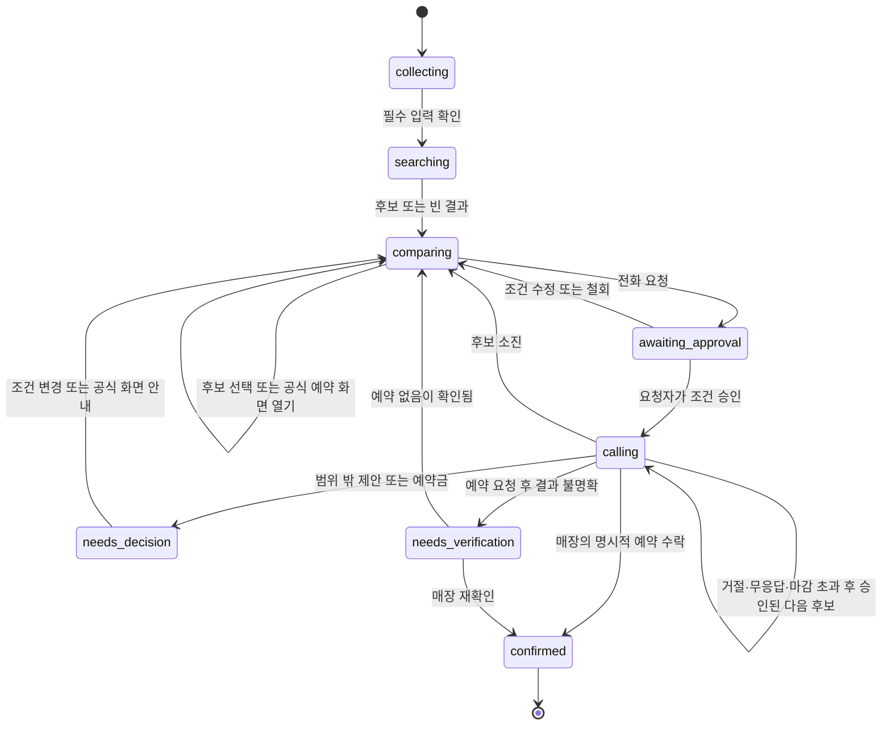

# LINE 여행 비서 스펙

작성일: 2026-11-25 · 상태: 팀 스펙 사본 (원본은 팀 Notion 「LINE 여행 비서」) · 시작 커밋: KokoSeoul `a855c50`

원본 Notion에서 붙여 넣은 사본이다. 원문에 있던 링크는 링크 이름만 남아 있다. 구현 범위와 진행 상황은 [구현 계획](LINE_AGENT_BUILD_PLAN.md)에 따로 적는다.

## 0. 왜 LINE 비서인가?

- 별도 앱 설치 없이 시작한다. 일본인 여행객은 평소 쓰는 LINE에서 일본어로 요청을 보낸다. 여기서울 전용 앱이나 네이버지도·지하철 종결자·캐치테이블·카카오 T 같은 국내 앱을 각각 설치하고 사용법을 익히는 과정 없이, 식당 후보와 대기 확인 경로, 다음 일정까지의 이동 정보를 같은 채팅에서 받는다. 기존 여기서울 화면은 필요한 순간에 웹 링크로 연다.
- LINE을 검색·예약·이동의 공통 창구로 쓴다. 이용 가능한 API나 공개 데이터가 있는 서비스는 LINE에서 요청을 받아 조회하고, 결과를 같은 대화에 정리한다. 지도·대중교통에서 시작해 웨이팅·예약·택시로 넓힐 수 있다. 네이버지도 API는 기존 여기서울 웹 지도에 연동해 검증한 자산을 재사용한다. 예약 확정이나 택시 호출처럼 외부 서비스에서 진행해야 하는 작업은 공식 화면으로 연결하고, 연동 범위는 서비스별 API와 이용 조건을 확인해 정한다. (기존 지도 연동 기록 · 구성 요소와 API)
- 카카오톡 플러스친구처럼 QR로 LINE 공식 계정을 친구 추가한다. 혼자라면 1:1로 대화하고, 일행이 있다면 그룹 참여를 허용한 공식 계정을 기존 단톡방에 초대한다. 예약 비서는 같은 대화에서 요청을 받고 일행의 조건이 바뀌면 다시 판단해 결과를 공유한다. (QR 친구 추가 가이드 · LINE 그룹 채팅 공식 문서)

서울에서 일행과 먹고 싶던 메뉴를 포기할 뻔했을 때, 평소 쓰는 LINE에 일본어로 한 번 부탁하면 된다. 비서는 실제 식사 인원, 메뉴, 다음 약속을 기억하고, 첫 식당이 막히면 조건에 맞는 다음 선택지를 찾아 일행에게 알려준다.

| 선택 | 근거와 제품에 반영한 점 |
| --- | --- |
| LINE을 첫 접점으로 쓴다 | LY Corporation에 따르면 일본 내 LINE 월간 활성 이용자는 약 1억 명, 일본 전체 인구 대비 81.3%다. 2026년 3월 말 활성 이용자 기준이며, 서울을 방문한 일본인만의 이용률은 별도 지표다. 일본인 방한 경험자 400명 조사에서 예상 밖의 불편을 겪은 134명 중 47.8%가 현지 앱 사용법, 46.3%가 한국어 소통에 어려움을 겪었다. 익숙한 채팅에서 일본어로 요청하고, 필요한 순간에만 한국의 지도와 예약 서비스를 열게 한다. (LINE 이용자 통계 · 일본인 방한 경험자 설문) |
| 혼자든 일행이든 실제 식사 인원을 받는다 | 2025년 서울 방문 일본인 조사에서 혼자 14.7%, 2인 49.0%, 3인 22.7%, 4인 8.5%, 5인 이상 5.1%였다. 여행 동행 인원 기준이며 현재 식사 인원은 요청할 때 받는다. 혼자는 1:1, 일행은 단톡방에서 같은 흐름을 쓰고, 5인 이상부터 단체석과 사전 예약을 우선 확인한다. (서울관광재단 원본 통계표 · LINE 그룹 채팅 공식 문서) |
| 첫 과제는 ‘다음 일정에 맞춰 같이 식사하기’다 | 2024년 방한 일본인의 90.8%가 식도락 관광에 참여했다. 실제 성수 2인 여행기에는 개점 전 대기 17번째였던 사례가 있고, 3인 여행기에도 시간대에 따른 식당 대기가 기록됐다. 혼자여서 먹고 싶던 메뉴를 주문하지 못한 응답도 있었다. 현재 대기와 이동 시간을 보고 착석 마감까지 들어갈 수 있는지 다시 판단하는 이유다. 여행 후기는 상황을 보여주는 사례이며, 대기나 예약 실패의 발생률은 이 자료에서 알 수 없다. (한국관광공사 일본편 · 성수 2인 여행기 · 서울 3인 여행기 · K Village 조사) |
| 상황이 바뀌면 요건을 기억하고 다음 행동을 한다 | 캐치테이블 글로벌에서 지원 매장의 예약·대기를 확인할 수 있고, LINE도 그룹 대화의 맥락을 쓰는 `Agent i in chat`을 발표했다. 여기서울은 사용자가 공유한 대기 결과를 이동 시간과 함께 판단하고, 필요할 때 승인받은 한국어 전화 문의를 이어간다. 매장 답변이 바뀌면 인원·메뉴·도착 마감을 유지해 후보를 다시 고르고, 결과와 길찾기를 같은 방에 보낸다. (캐치테이블 글로벌 안내 · 테이블링 공식 안내 · Agent i in chat 발표) |

검증할 가설은 일본인 여행객이 한국어 전화 때문에 원하던 예약을 포기하거나 계획을 바꾼 사례가 반복되는지다. 공개 자료는 여행 활동과 현장 불편의 배경을 보여준다. 전화 대행 수요는 팀 인터뷰에서 실제 예약 시도와 결과를 추가로 확인한다.

## 1. 제품과 성공 조건

서울을 여행하는 일본인이 평소 쓰는 LINE에 일본어로 부탁하면, 일행이 갈 식당을 찾아 웨이팅과 다음 일정에 맞는지 판단한다. 온라인 예약·대기가 가능한 곳은 공식 화면을 연다. 한국어 문의가 필요한 곳은 사용자가 승인한 조건 안에서 AI가 전화를 걸고 결과를 LINE으로 보낸다. 식당을 정하면 여기서울에서 식당까지의 이동과 식사 후 다음 이동을 안내한다.

예시 요청은 「新村にいます。2人でサムギョプサルを食べたいです。20時までに弘大のライブ会場に着きたいです。」다. 식당 추천 카드가 나온 시점, 대기 등록 시점, 매장의 예약 수락 시점, 실제 방문 시점을 각각 구분한다. 아래의 수치와 제한은 별도 출처가 없는 경우 팀 검토용 초기값이다.

| 대상과 근거 | 범위 |
| --- | --- |
| 첫 사용자 | 오늘 서울에서 식사하려는 일본어 이용자. 혼자 또는 일행과 LINE을 쓰며, 장소·시간·메뉴 중 지키고 싶은 조건이 있다. |
| 인원 근거 | 서울관광재단 2025년 외국인 실태조사 일본인 표본 1,085명. 본인 포함 1인 14.7%, 2인 49.0%, 3인 22.7%, 4인 8.5%, 5인 이상 5.1%. A2의 혼자 비율과 A2-1의 동행자가 있는 응답자 분포를 일본인 전체 가중 기준으로 환산했다. 여행 동행 인원과 개별 식사의 인원은 별개다. (공식 통계표) |
| 문제 근거 | 일본인 여행 후기에는 1인 주문 조건과 일행 식당 대기 사례가 있다. 팀 피벗 제안서의 11/24 인터뷰는 4명이며 짧은 여행 일정과 한국 앱 이용에 대한 정성 근거다. 한국어 전화로 인한 예약 포기의 빈도와 지불 의향은 검증 가설이다. (K Village 조사 · 성수 2인 여행기) |
| 완료 기준 | 실제 LINE에서 식당 검색, 공식 대기 링크, 새 대기 정보에 따른 재계산, 기존 여기서울 경로 연결까지 실행된다. 팀원 전화에서 거절 후 대안 발신과 테스트 예약 확정이 재현된다. 한·일 양쪽에서 같은 상태와 복구 행동을 제공한다. |

## 2. 구현 범위

| 기능 | 제휴 없는 MVP |
| --- | --- |
| 접점 | LINE 공식 계정 1:1 및 그룹 채팅. 그룹은 명시적 호출이나 버튼으로 식사 요청을 시작한다. 활성 요청을 시작한 사람이 변경·전화·확정을 승인한다. |
| 식당 검색 | 서울 신촌 검증 후보를 우선 제공하고 네이버 지역 검색으로 보충한다. 성수는 동일 구조로 검증 가능한 두 번째 지역이다. 후보 카드는 최대 3곳이다. |
| 인원 | 1명은 혼자 입장과 요청 메뉴 1인분 주문을 각각 확인한다. 2~4명은 실제 인원으로 예약 화면을 확인하고 함께 착석하는 조건을 다룬다. 5명 이상은 단체 예약 모드로 진입해 단체석, 한 테이블, 사전 예약을 우선한다. 검증된 정원보다 인원이 많으면 다른 후보를 제시한다. |
| 웨이팅·온라인 예약 | 사용자가 매장별 공식 링크에서 조회·접수·예약한다. 봇은 사용자 입력이나 캡처를 읽어 출처와 관측 시각을 표시한다. 예약 앱의 확인 화면은 사용자가 공유한 기록으로 표시한다. |
| 전화 | 기능 플래그로 음성 발신을 켠다. 제휴 없는 시연은 동의한 팀원 폰 번호만 서버에서 매핑하고 카드와 확정 메시지에 테스트를 표시한다. 일반 매장은 공식 예약 화면이나 사용자가 직접 걸 수 있는 문의 경로를 제공한다. 실매장 발신은 별도 시험 범위 승인과 업체 동의를 전제로 확장한다. |
| 이동·기존 자산 | 식당까지 및 다음 일정까지 두 구간. 지하철 안내, 한국어 예약 확인 카드, 역 스탬프·도감, 출구 주변 퀘스트·모험의 서를 순서에 맞춰 연결한다. 기존 서비스 진입 경로와 독립적으로 사용할 수 있다. |
| 거래 범위 | 전화 요청은 사용자가 승인한 시간·인원·후보에 한정한다. 유료 예약·예약금·카드 번호·자동 취소 또는 변경은 공식 화면이나 직접 문의로 처리한다. |

## 3. LINE 사용자 흐름과 한·일 문구

1. 요청 시작. 지역 또는 현재 역, 실제 식사 인원, 메뉴나 식당 이름을 수집한다. 다음 일정이 있으면 장소와 도착 마감을 함께 받는다. 시간·장소가 모호할 때 가장 중요한 항목 하나부터 질문한다. 다음 일정이 없으면 이동 시간과 대기 정보를 중심으로 추천한다.
2. 결과 선택. 후보마다 상호·지점·위치, 도보 또는 대중교통 시간, 인원 조건의 확인 상태, 대기 출처를 표시한다. 일정이 있으면 착석 마감과 그 근거를 함께 보여준다. 상호가 같아도 지점이 다르면 선택을 받는다.
3. 대기 확인. 공식 화면 링크를 열거나 사용자가 캡처·텍스트를 공유한다. 장소·단위·시각이 불명확하면 해당 후보와 값만 확인해 달라고 요청한다. 카드는 접수 여부와 남은 팀 수, 원본이 제시한 예상 분을 구분한다.
4. 전화 요청. 발신 전 가게 목록, 순서, 인원, 시간 범위, 전달할 예약자 이름 또는 별칭을 보여준다. 여러 곳을 승인해도 한 번에 한 곳만 발신한다. 이름·전화번호 등 개인 정보 입력이 필요하면 해당 요청자와의 1:1에서 수집하고, 그룹에는 일정 결과만 보낸다.
5. 선택·확정. `여기로 갈게요`는 목적지 선택이다. 전화로 매장이 수락하거나 사용자가 공식 예약 결과를 공유한 경우에는 출처를 붙여 별도 예약 상태를 표시한다.
6. 이동. 첫 행동은 `식당으로 가기`다. `다음 일정으로 가기`는 선택 후에도 남는 보조 행동이다. 기다릴 시간이 확인됐을 때만 근처 체험을 보조로 제안한다.

| 상태 | 일본어 | 한국어 |
| --- | --- | --- |
| 인원 입력 | 今回、お食事は何名ですか？ | 이번 식사는 몇 명이세요? |
| 시간이 부족함 | 20時に着くには、18時45分までに席に着く必要があります。別のお店を探しますか？ | 20시까지 도착하려면 18시 45분까지 앉아야 해요. 다른 식당을 찾을까요? |
| 팀 수만 보임 | 前に8組います。待ち時間は表示されていません。 | 앞에 8팀이 있어요. 예상 대기 시간은 표시되지 않았어요. |
| 공식 화면으로 이동 | 予約・順番待ちを確認 | 예약·웨이팅 확인 |
| 발신 승인 | この条件で電話を頼む | 이 조건으로 전화 부탁하기 |
| 승인 범위 밖의 제안 | お店から19時の提案がありました。20時までの到着には間に合いません。 | 매장에서 19시를 제안했어요. 20시까지 도착하기 어려워요. |
| 예약 결과 확인 필요 | 予約が取れたか確認できませんでした。お店に確認してください。 | 예약 확정 여부를 확인하지 못했어요. 매장에 확인해 주세요. |
| 이동 | お店への行き方を見る | 식당으로 가는 길 보기 |

기본 언어는 일본어다. 사용자가 선택한 표시 언어를 요청에 적용한다. 각 메시지에 가장 중요한 행동 하나를 강조하고, 한국어와 일본어에서 같은 상태와 복구 방법을 제공한다. (여기서울 UX 원칙)

## 4. 증거·시간 계산·추천 규칙

### 정보에 붙이는 출처

| 정보 | 저장할 사실 | 화면 표시 |
| --- | --- | --- |
| 검색 | 제공자, 상호·지점, 좌표, 조회 시각, 원본 링크 | 검색 후보. 매장 수용 인원·메뉴 재고·빈자리는 미확인 |
| 예약 링크 | 매장 식별자, 제공자, HTTPS URL, 검수 날짜 | 예약 또는 대기 확인. 링크 존재만으로 접수 가능하다고 판단하지 않음 |
| 사용자 대기 정보 | 매장 ID, 원본 유형, `reportedAt`, `observedAt` 또는 미상, 분 또는 팀 수, 등록 상태 | 사용자 공유 · 시각. 시각 미상·오래된 화면은 다시 확인 요청 |
| 전화 | 매장, 시도 ID, 응답 결과, 제안·수락 시각, 인원, 확인 시각 | 문의 결과 또는 예약 확정. 수락 증거는 예약된 인원·일시와 일치해야 함 |
| 경로 | 구간별 시작·종점, 제공자, 분, 조회 시각, 이동 방식 | 이동 예상 시간. 경로 오류 또는 미확인은 해당 구간에 표시 |

초기값은 대기 관측 10분, 이동 예상 5분이 지나면 다시 확인하도록 안내하는 것이다. 관측 시각이 없는 캡처는 현재 정보인지 확인을 받는다. 접수 전의 대기 예상, 이미 접수한 대기 예상, 입장 가능 시각을 서로 다른 값으로 보관한다. 앞 팀 수에 단순 상수를 곱해 분으로 계산하지 않는다.

### 시간 판정

- 시간대는 `Asia/Seoul`이다. 저장은 절대 시각으로 하고 표시할 때 서울 시간으로 변환한다. 사용자가 입력한 시각이 자정을 넘거나 날짜가 불명확하면 날짜를 확인한다.
- `착석 마감 = 다음 도착 마감 - 식사 시간 - 식당→다음 장소 이동 - 여유 시간`. 기본 식사 45분, 여유 10분이며 카드에서 수정할 수 있다.
- `착석 예상 = max(식당 도착 예상, 제공자가 알려 준 입장 가능 시각)`. 대기가 현장 도착 후 시작한다고 확인됐으면 `식당 도착 예상 + 대기 분`을 사용한다. 이미 원격 대기를 접수했고 지금부터의 예상임을 확인했다면 `관측 시각 + 대기 분`과 식당 도착 예상 중 늦은 값을 사용한다. 기준을 알 수 없으면 계산에 넣기 전에 묻는다.
- 원격 대기 호출 뒤 입장 유예 시간이 표시되면 식당 도착이 그 기한을 넘는지도 확인한다. 대기·이동 시간이 불명확하면 결과를 `미확인`으로 두며 예약 가능 판정과 분리한다.
- 정상 예시로 17:45 출발, 식당까지 10분, 공연 19:30 도착, 식사 45분·이동 20분·여유 10분이면 착석 마감은 18:15다. 현장 도착 후 40분 대기면 18:35 착석 예상으로 20분 초과다. 출발 시점부터 이미 원격 대기 중인 경우에도 18:25로 10분 초과다.
- 후보는 확인 가능한 필수 조건, 다음 일정 충족 가능성, 알려진 대기와 이동, 사용자 선호 순으로 비교한다. 후보가 줄어들어도 시간·인원·필수 메뉴를 임의로 바꾸지 않는다. 바꾸면 결과가 달라질 조건 한 가지를 물어본다.

### 대기 시간에 퀘스트 제안

사용자가 원하고 복귀 시각을 판단할 수 있을 때만 추천한다. `쓸 수 있는 시간 = 매장 복귀 마감 - 현재 시각 - 장소까지 도보 - 매장 복귀 도보 - 여유 시간`으로 계산한다. 호출 시간이나 복귀 기한이 미확인이면 여유 시간을 확정하지 않는다. 왕복 도보와 퀘스트 소요 시간의 합이 맞는 항목을 최대 1개 제안한다. 검색 API의 거리는 출구 기준 직선거리이므로 왕복 시간은 도보 경로로 확인한다.

## 5. 상태와 전화 실행 계약

- 예약 상태와 식당 선택 상태를 분리한다. 공식 사이트를 열거나 목적지를 선택한 이벤트는 서버 예약을 만들지 않는다. 참가자가 공유한 외부 예약은 `외부 예약 · 사용자 공유`로 표시한다.
- 전화 승인에는 `requestId`, `revision`, 요청자, 승인한 후보 ID 및 순서, 서울 날짜, 시간 범위, 인원, 예약자 별칭, 발신 횟수와 만료를 묶는다. 초기값은 후보 최대 2곳, 후보당 1회, 승인 유효 10분이다. 조건 변경은 새 revision과 새 승인을 요구한다. 사용자가 취소하면 아직 시작하지 않은 발신을 폐기한다. 이미 예약됐을 가능성이 있으면 결과 확인을 안내한다.
- 매장이 허용 범위 안의 조건을 제안하면 날짜·시각·인원·이름을 한국어로 복창하고 명시적 수락을 받는다. 첫 문장은 “일본인 손님의 예약을 도와드리는 AI 비서입니다”다. 해당 시간으로 다음 일정에 맞출 수 없으면 이미 승인받은 다음 후보로 넘어간다. 그 외 승인 범위 밖 제안이나 예약금·결제·이름 불일치가 있으면 상태를 저장하고 통화를 마친 뒤 LINE으로 묻는다. 사용자가 다시 승인하면 자리 재확인부터 시작한다.
- 음성 모델은 `no_answer`, `declined`, `alternate_offered`, `confirmed`, `unknown` 형태의 결과를 제출한다. 전화망에서 수신한 `completed`는 통화 종료 상태다. 예약 확정에는 전화 시도와 연관된 매장 수락 및 예약 정보 검증이 필요하다. *예약 요청 이후* 응답 유실·타임아웃·불명확한 답변이 발생하면 `needs_verification`으로 멈춘다. 앞 매장에 이미 예약됐을 수 있으므로 다음 매장에 전화하지 않는다.
- 워커가 통화 시도 행을 먼저 만들고 공급자 ID를 연결한다. 외부 요청이 타임아웃되어 접수 여부가 불명확하면 조회·콜백을 기다린다. 상태를 모르는 발신을 새 번호 요청으로 재시도하지 않는다. 최종 전송 실패 시 LINE에 같은 예약을 다시 요청하지 않고 기존 결과 카드만 재전송한다.

## 6. 구성 요소, API와 링크

| 역할 | 구현 경로와 계약 |
| --- | --- |
| LINE 수신 | 신규 `POST /api/v1/integrations/line/webhook`. raw body 서명 검증 후 이벤트를 DB에 기록하고 빠르게 응답한다. 그룹은 공식 계정의 그룹 참여 설정을 켜야 한다. 명시적 호출의 텍스트, 활성 요청의 버튼, 사용자가 지정해 전달한 위치·대기 이미지가 처리 대상이다. (그룹 채팅 · 웹훅·이미지 조회) |
| LINE 결과 전달 | 즉시 접수 안내는 reply, 비동기 검색·통화 결과는 push. 버튼은 postback으로 요청 ID·revision·행동을 넘기고 서버에서 요청 권한과 상태를 검사한다. 외부 링크는 지원되는 HTTPS URI로 전달한다. (Messaging API · 결과 푸시 API) |
| 자연어·캡처 | 기존 요청과 함께 한국어 검색어와 구조화 필드만 얻는 텍스트·이미지 모델 어댑터. 서버가 값과 범위를 검증하고, 모델은 미확인을 표현한다. 승인과 발신 결정 및 시간 계산은 서버가 맡는다. |
| 장소 검색 | NAVER API HUB `GET /search/v1/local`. 업체명·주소·좌표·상세 링크 사용. 검증한 매장 식별자와 지점을 먼저 맞춘다. API의 `telephone`은 값을 반환하지 않는다. 전화번호와 공식 예약 링크는 검증 후보 데이터로 관리한다. (지역 검색 명세) |
| 이동 예상 | ODsay `searchPubTransPathT`로 대중교통, 기존 TMAP 도보 모듈로 도보 예상 시간. 근거리 도보 구간은 도보 제공자로 따로 계산한다. 검증된 두 지점으로 요청하고 네트워크 오류가 나면 남은 경로만 보여준다. (ODsay 경로 API · TMAP API) |
| 실제 예약·웨이팅 | 매장별 공식 링크를 연결한다. 공개 연동 계약을 확보할 때까지 검색 결과나 웹 화면을 실시간 빈자리 API로 취급하지 않는다. 가게와 예약 플랫폼의 지점이 일치할 때만 링크를 노출하고, 없으면 업체 페이지를 연다. (캐치테이블 글로벌 · 테이블링 · 테이블링 매장 페이지 예시) |
| 음성·전화망 | 우선 Twilio 발신 + `<Connect><Stream>` + 한국어 음성 모델 조합을 검증한다. 전화 상태 콜백과 음성 예약 결과를 구분한다. 양방향 오디오 서버는 지속 가능한 WSS 런타임에 둔다. 대안은 GPT-Live 발신 SIP와 TLS/SRTP 지원 트렁크다. 승인 없이는 어느 어댑터도 실행하지 않는다. (Twilio 음성 · 양방향 스트림 · OpenAI 발신 SIP) |
| 추가 지도 안내 | 앱 연결이 가능한 HTTPS 중계 화면에서 네이버지도 길찾기를 열거나 웹 지도·주소 복사를 제공한다. 앱 미설치와 LINE 인앱 브라우저 동작은 Android·iOS에서 각각 확인한다. (네이버지도 URL Scheme · 네이버지도 웹) |

웹·웹훅은 기존 Next.js App Router에서, 상태는 PostgreSQL·Drizzle에서 관리한다. 비동기 실행은 영속 작업 큐와 워커가 필요하다. 전화 스트림은 배포 환경에서 지원하는 별도 WSS 런타임을 쓴다. Vercel 로그인 보호가 적용된 기존 Preview는 UI 확인에 계속 사용할 수 있다. LINE·전화망의 콜백은 로그인 리다이렉트가 없는 외부 도달 가능한 HTTPS 주소에서 서명을 검증한다. 게이트가 분리된 환경을 사용하고 기존 Preview 전체의 보호를 해제하지 않는다.

### 내부 경계

| 입력 | 출력과 처리 책임 |
| --- | --- |
| `InterpretRequest` · 최근 요청 상태와 명시적으로 제공된 텍스트 | 인원, 현재 장소 후보, 메뉴, 도착 마감, 검색어, 확인할 항목. 서버가 원본 도시·인원·시간을 검증하고 모호한 값은 사용자에게 돌려준다. |
| `ReadWaitEvidence` · 선택한 후보와 캡처 또는 텍스트 | 매장 식별 후보와 대기 분·팀 수·원본 시각·기준. 판독 신뢰도가 낮거나 매장명이 충돌하면 확인 요청으로 반환한다. |
| `ComputePlan` · 후보, 대기 증거, 경로 결과, 시간 제약 | 후보별 `fits`, `late`, `unknown`, 착석 마감, 불확실한 항목. 동일 입력의 결과는 항상 같다. |
| `StartCall` · 발신 승인 ID와 후보 ID | 승인·만료·revision·허용 번호를 검증한 뒤 한 건의 시도를 기록한다. 브라우저·모델에는 발신 API를 직접 열지 않는다. |
| `ReportCallOutcome` · 통화 시도 ID, 제안 또는 수락, 검증 필드 | 발신 후보·인원·시간과 대조해 허용된 상태로 전환한다. 처리 가능한 도구는 이미 승인된 통화 시도에만 연결한다. |

## 7. 기존 여기서울 재사용 계약

| 기존 기능과 코드 | 바로 쓸 수 있는 부분 | 연결에 필요한 작업 |
| --- | --- | --- |
| 지하철 페이지 · 목적지 해석 | `/subway?to=<역 코드>`나 `?quest=<slug>`로 목적지 전달. 기존 네트워크가 지원하는 역에서 행선지·환승 흐름 사용 | 현재 `station` 파라미터는 역 현장 가이드 선택에 쓰인다. 경로 출발역 자동 입력을 보장하지 않는다. 출발역 입력 계약을 추가하거나 사용자가 기존 화면에서 출발역을 고르게 한다. 일반 식당의 출구와 최종 도보는 별도 데이터로 연결한다. |
| TMAP 도보 모듈 · 공개 도보 경로 | 서버 모듈의 좌표 검증, 타임아웃, 파서, 짧은 캐시 재사용 | 기존 공개 엔드포인트는 등록된 데모 퀘스트 ID를 받는다. 비서가 검증한 좌표는 서버 모듈에서 직접 계산한다. 기존 브라우저 API의 요청 형식은 그대로 사용한다. |
| 출구 주변 검색 · 근처 퀘스트 API | `/quests/nearby?originId=<출구 UUID>&radiusM=800` 및 서버 검색 로직 | 확인된 출구만 넘긴다. 출구 ID가 없으면 임의 매핑하지 않고 선택 화면 또는 지도 안내를 제공한다. 시간에 맞는 후보는 추가로 왕복 도보와 운영 조건을 확인한다. |
| 모험의 서 · 스탬프 도감 | 노선·역 상세, 체험에서 도감으로 왕복, 기존 GPS 획득·PNG | 역 또는 퀘스트 ID는 기존 빌더·검증 로직으로 변환한다. 예약·경로 열기는 스탬프 획득 조건을 바꾸지 않는다. 기존 기록은 브라우저·origin에 저장되므로 LINE 인앱 브라우저와 외부 브라우저 간 공유를 약속하지 않는다. |
| 한국어 카드 | 현장에서 화면을 보여주고 의미를 한·일로 확인하는 기존 패턴 | 예약된 인원·시각·별칭만 채운다. 개인 입력이나 전체 통화 내용은 공유 링크에 싣지 않는다. |

LINE 이동 버튼은 검증된 장소와 구간을 연결하는 HTTPS 화면을 연다. 직후에 보여줄 정보는 목적지 이름, 가장 적합한 이동 수단, 다음 행동 하나다. 출발지·다음 장소·예약자 정보가 그룹 채팅 밖으로 불필요하게 새지 않도록, URL에는 검증된 공개 장소 식별자 또는 만료되는 불투명 토큰만 넣는다. 토큰 링크는 전달될 수 있으므로 이동 정보에만 쓰고 예약 상세는 LINE 요청 안에서만 보여준다.

## 8. 데이터 모델과 정합성

| 새 저장 단위 | 필드와 제약 |
| --- | --- |
| `dining_requests` | ID, 환경, 대화 유형 및 대화 키, 요청자 키, 언어, 상태, revision, 식사 인원, 메뉴·필수 조건, 출발·다음 장소, 서울 일정, 만료. 초기값은 대화당 활성 식사 요청 1개다. 같은 방에서 새 요청을 만들 때 기존 요청을 교체하는지 확인한다. |
| `dining_candidates` | 요청 ID·revision, 후보 ID, 정확한 지점, 공개 좌표·주소, 정보 출처, 검증한 예약 링크, 추천 순서. 동일 요청의 같은 지점 중복 제거. |
| `dining_wait_observations` | 요청·후보 ID, 유형, 분·팀 수·호출 기한, 기준 시점, 관측·수신 시각, 사용자의 확인 상태. 새 관측이 이전 관측을 덮을 때 버전과 출처를 남긴다. |
| `dining_call_approvals` | 요청·revision·요청자, 승인 후보와 순서, 인원·시간 범위, 만료 및 철회, 승인된 전달 필드. 승인 이후에 변경된 조건은 새 행에 저장한다. |
| `dining_call_attempts` | 승인 ID, 후보, 시도 번호, 공급자 ID, 전화망 흐름, 예약 결과, 응답 시각. `(approval_id, candidate_id, ordinal)`과 공급자 ID에 유니크 제약. 요청당 진행 중 발신 한 건. |
| `dining_reservations` | 요청 ID, 후보, 인원, 예약 시각, 증거 유형, 명시적 수락 시각, 별칭 참조. 요청당 활성 확정 한 건. 외부 예약은 사용자 공유 증거로 분리해 표시. |
| `integration_events`, `delivery_outbox` | 수신 공급자·이벤트 ID 중복 방지, job 및 목적지, 재시도·lease·만료. DB 상태 변경과 outbox 삽입을 한 트랜잭션에서 처리한다. |

그룹에 참여한 사람이 메시지를 보낼 수 있어도 발신과 예약을 승인할 권한은 요청자가 갖는다. 다른 사용자, 만료된 카드, 과거 revision의 postback은 실행하지 않고 현재 카드로 복귀한다. 조회·첨부·시간 계산 작업도 저장 직전에 revision을 다시 확인한다. 늦게 도착한 과거 응답이 최신 선택과 예약 상태를 덮지 못한다.

전화와 메시지 전송은 공급자 응답이 불명확하면 중복 실행 위험이 있다. 가능한 어댑터는 공급자 멱등 키를 전달하고, 전화는 확인되지 않은 시도에 새 시도 번호를 발급하지 않는다. 콜백 중복·순서 역전은 이벤트 키와 허용 상태 전이로 처리한다.

## 9. 보안·데이터 보존·운영

- LINE 서명은 원본 body로 검증한다. 전화망 콜백 및 WSS 연결은 해당 공급자의 서명을 검증하고 발신 ID를 기존 시도에 연결한다. 설정에는 공개 URL, LINE 채널 키, 장소·교통 API 키, 전화 자격 증명과 테스트 발신 번호 허용 목록이 필요하다. 환경별 Secret Store로 관리한다.
- 사용자가 올린 URL·캡처·통화 발화는 데이터로 취급한다. 발신 번호와 외부 링크는 서버의 검증 목록에서 선택한다. 모델의 자유 입력으로 전화번호, URL 또는 결제 금액을 결정하지 않는다.
- 그룹 대화 전체를 저장하거나 모델에 보내지 않는다. 활성 요청에 사용자가 명시적으로 제공한 텍스트·이미지만 처리한다. 원본 캡처와 오디오는 기본 비저장으로 두고, 추출한 대기 정보와 통화 결과만 남긴다. 공급자 보존 옵션은 배포 전 확인한다. 로그에 LINE ID 원문, 개인 연락처, 위치 원문, 대화, 모델 입력, 인증 헤더를 남기지 않는다.
- 제안 보존 기간은 활성 요청 6시간, 만료된 개인 연결 데이터 및 임시 토큰 정리 24시간 이내, 개인을 연결할 수 없는 집계 30일이다. 테스트·운영 환경에 모두 같은 만료 규칙을 적용한다. 실제 예약 확인이 필요한 예외 보존 기간은 운영 전 별도 결정한다.
- 식당 검색이나 이동 정보 장애 시 공개 지도·공식 링크를 제공한다. 이미지 판독이 어려우면 `대기 분 입력`을 제공한다. 전화 기능의 긴급 중지 시에는 새 발신을 중단하고 이미 시작된 시도는 결과 확인 상태로 끝낸다. (여기서울 보안·개인정보 기준 · 백그라운드 작업 기준)

## 10. 구현 순서와 인수 기준

| 단계 | 작업과 인수 조건 |
| --- | --- |
| 1. 실제 LINE과 후보 검색 | 그룹·1:1 접수, 일본어/한국어, 요청자 권한, 인원 분기, 신촌 후보와 공식 링크. 동일 이벤트를 두 번 받아도 요청은 한 건. |
| 2. 웨이팅·일정 계산 | 동일 요청의 텍스트·캡처 대기 갱신, 시간 판단, 대안 2~3곳. 숫자·단위 누락과 경로 실패에서도 사실과 확인 방법이 표시됨. |
| 3. 여기서울 이동 연결 | LINE에서 식당으로 가는 구간과 다음 장소로 가는 구간을 각각 연다. 대상 역이 기존 안내에서 선택되고 출발을 지정할 수 있다. 지도 앱이 없어도 이동 정보 또는 주소 확인 가능. |
| 4. 팀원 폰 발신 | 동의한 팀원 번호로 실제 양방향 한국어 통화. 첫 후보 거절 → 다음 후보 수락 → 결과 push. 승인 없이 발신되지 않고 중복 콜백에서 발신·예약 확정·결과 발송이 중복되지 않음. |
| 5. 기존 체험 연결 | 복귀 가능 시간이 확인된 대기 중에만 주변 퀘스트를 연결한다. 역 도감 진입과 기존 획득·PNG 동작을 회귀 검증한다. 실제 GPS 획득은 실기기 검증으로 분리한다. |

전화 연결 검증은 1~3단계와 병렬로 시작한다. 팀 내 담당은 LINE·요청 상태, 장소·이동·기존 자산 연결, 음성·전화망, 콘텐츠·실기기 검증으로 나눌 수 있다. 음성 경로가 검증되지 않아도 검색·대기·이동 흐름은 시연 가능하다.

| 검증 ID | 재현 및 기대 결과 |
| --- | --- |
| LINE-01 | 1명·2명·4명·5명·8명 입력. 실제 인원이 유지되고 5명부터 단체 확인 조건이 나온다. 일본어·한국어 동등. |
| LINE-02 | 그룹의 다른 참가자가 발신 버튼을 누름. 요청자만 승인 가능. 두 사람이 동시에 후보를 선택하고 오래된 카드가 다시 눌려도 요청 revision이 일관됨. |
| WAIT-01 | 8팀만 보이는 화면, 40분 예상 화면, 다른 지점 화면, 시각 없는 오래된 화면을 각각 공유. 단위·지점·출처가 구분되고 불확실하면 묻는다. |
| ETA-01 | 18:15 착석 마감과 18:35 예상 사례, 마감과 정확히 같은 시각, 날짜 넘김, 이동 조회 실패를 검증한다. 자정 처리와 정확히 마감에 맞는 판정이 일정에 반영된다. |
| CALL-01 | 첫 후보 거절, 두 번째 팀원 수락. 승인 범위와 인원이 유지되고 일본어 테스트 확정이 한 번 발송된다. |
| CALL-02 | 승인 만료, 범위 밖 시각, 예약금, 번호 허용 목록 미일치, 콜백 재전송, 발신 접수 유실을 재현한다. 잘못된 발신, 중복 예약, 자동 결제가 일어나지 않는다. |
| CALL-03 | 매장에 예약을 요청한 뒤 통화가 끊긴다. 기존 예약의 성립 여부를 확인하기 전까지 다른 후보로 발신하지 않는다. |
| MOVE-01 | LINE Android·iOS에서 HereSeoul과 네이버지도 연결, 앱 미설치 복구, 역·출구·주소 전달, 돌아가기 확인. |
| REUSE-01 | 퀘스트 왕복과 복귀 마감이 맞을 때만 추천. 기존 역 GPS 게이트, 환승역 중복 집계, 도감 PNG에 회귀 없음. |

### 참가 기업의 사업과 맞닿는 기능

사업과의 접점은 하나의 예약 시나리오 안에서 보여준다. 킥오프의 공식 심사는 사용자에게 제공한 기쁨·편리함, 기술력·완성도, 재미·독창성, 과제 발견·해결력, 팀 개발을 평가한다. 아래 대응은 발표 구성이며, 기업별 별도 평가 기준을 뜻하지 않는다. 출처는 킥오프 자료 「DigiMan Hackathon powered by KOREC」 PDF 11·13·15·17쪽(참가 기업), 34쪽(발표), 40쪽(심사 기준)이다.

| 참가 기업 | 사업과의 접점 | 시연에서 확인할 기능 |
| --- | --- | --- |
| DigiMan | 영업 대행과 AI 도입 지원에서 실제 연락과 후속 처리를 수행한다. | 첫 매장이 제시한 시각이 다음 일정과 맞지 않으면, 에이전트가 인원·메뉴·도착 마감을 유지하고 승인된 다음 후보에 발신한다. (DigiMan 공식 소개) |
| ship | 생성형 AI 도입과 제품 개발을 지원하며 AI 탑재 CRM, LINE 운영 도구를 개발한다. | 공식 계정을 QR로 추가한 뒤 실제 LINE에서 일본어 요청, 후보 확인, 전화 승인, 결과 수신까지 이어간다. (ship 공식 사이트 · LINE 공식 계정 개발 가이드) |
| GARO | 경영자 전용 커뮤니티 `Rep`에 AI를 결합해 의사결정을 돕는다. 여기서울의 접점은 정보를 공유하고 다음 행동을 정하는 경험이다. | 일행이 단톡방에서 첫 후보가 어려운 이유와 대안의 시간 조건을 함께 확인한다. 선택한 식당과 경로는 같은 방에 공유한다. (GARO 회사 소개 · Rep 공식 발표) |
| AI DOG | 음성 AI와 고객지원용 전화 봇을 개발한다. | 실제 한국어 양방향 통화를 들려준다. 식당의 제안 시각을 이해하고, 예약 시각과 인원을 복창한 뒤 명시적 수락을 결과에 반영한다. 출처는 킥오프 자료 PDF 17쪽이다. |

### 3분 시연

> 2026-11-26 변경: 시연은 "가고 싶은 가게의 링크를 보내면 오늘 되는지 답한다"로 시작한다. 바뀐 대본은 [구현 계획의 제품 초점과 3분 시연](LINE_AGENT_BUILD_PLAN.md#제품-초점과-3분-시연-2026-11-26)에 있다. 아래는 원래 대본이다.

| 시간 | 시연 내용 | 화면 또는 통화에서 확인할 결과 |
| --- | --- | --- |
| 0:00–0:35 | 심사위원이 QR로 공식 계정을 추가한 뒤 준비된 LINE 단톡방에서 일본어로 요청한다. 「新村で2人、サムギョプサルが食べたいです。20時までに弘大のライブ会場に着きたいです。」 | 후보와 식사 인원 2명, 18:45 착석 마감을 표시한다. 식사 45분, 공연장까지 이동 20분, 여유 10분을 반영한 예다. |
| 0:35–1:05 | 첫 후보의 대기 화면이나 예상 대기 분을 공유한다. | 봇이 공유된 대기로 착석 마감을 넘길 것으로 판단하고, 인원과 메뉴를 유지한 전화 문의 후보를 제시한다. |
| 1:05–2:20 | 심사위원이 후보와 시간 범위를 승인한다. 에이전트가 팀원 휴대폰에 발신한다. 첫 매장 역할은 19시만 가능하다고 답하고, 다음 매장 역할은 18:30에 두 명이 가능하다고 답한다. | 통화 음성을 들려주고, 19시 제안을 받은 뒤 조건을 재입력하지 않아도 다음 후보로 넘어가는 과정을 보여준다. 에이전트가 시간·인원을 복창하고 상대가 수락한 뒤 테스트 예약을 확정한다. |
| 2:20–3:00 | LINE 단톡방에 일본어 결과가 도착한다. `식당으로 가는 길 보기`를 눌러 기존 여기서울 지하철 안내를 연다. | 매장·인원·예약 시각이 같은 방에 공유된다. 식당까지 가는 안내를 열고 다음 일정까지 가는 경로도 확인한다. |

시연의 핵심은 첫 전화에서 19시만 가능하다는 답을 받은 뒤, 에이전트가 다음 일정에 맞는 후보를 다시 확인해 결과를 전달하는 단계다. 전화는 동의한 팀원 번호로 실제 발신하며, 화면과 결과 카드에 테스트 예약임을 표시한다. 역 스탬프와 주변 퀘스트는 이동 화면에서 접근할 수 있음을 보여준다.

### 검증할 가설과 측정

- 사용자 검증에서는 최근에 정말 가고 싶었던 가게, 예약 방식, 포기하거나 바꾼 이유를 묻고 사례를 기록한다. 인터뷰 응답과 모의 데모 결과는 별개로 집계한다.
- 기존 방식과 비교해 실행 가능한 후보를 찾는 데 걸린 시간, 사용자가 바꿔 연 앱 수, 일행의 조건을 반복 입력한 횟수, 실제 선택 또는 확인 성공률을 기록한다. 전화는 한국어 응답 품질, 무응답·거절·명시 수락 비율, 중복 발신 여부를 별도로 본다.
- 팀 확인 사항은 통화 사업자·한국 발신 연결성, 그룹과 1:1 전환, 공개 웹훅 배포, 검증 전화번호, LINE iOS·Android, 주소·출구 매핑, 실제 매장 시험 운영 범위다. 본 문서는 실제 전화·예약 또는 실기기 검증 결과를 기록하지 않는다.

## 11. 조사 근거와 참고 자료

### 공식 통계·설문

| 원자료 | 확인한 내용과 스펙에 반영한 판단 |
| --- | --- |
| 서울관광재단, 2025 서울관광 실태조사 | 일본인 표본 1,085명의 본인 포함 인원 분포를 §1에 반영했다. 두 명이 최다이며 2~4인은 약 80%다. 개인별 응답으로 집계한 여행 동행 정보이며, 식사별 인원이나 인원별 불편 빈도는 이 문항에서 알 수 없다. 서울시가 같은 조사에서 인용한 일본인 평균 체류는 3.5일, 재방문율은 71.2%다. 짧은 일정에서 다음 예약을 보호하는 기능의 배경이다. (서울관광재단 통계표 · 서울시 인용) |
| 서울시, 일본인 탄환여행 사례 | 짧은 일정에 시장 식사, 쇼핑, 뷰티가 연달아 들어간 실제 여행 후기를 서울시가 소개했다. 여러 활동이 이어지는 사용 장면을 설계할 때 참고했다. 인용된 여행기는 개별 사례다. (서울시 발표) |
| 한국관광공사, 2025 국가별 방한관광시장 분석 | 2024년 전국 방한 일본인 기준 식도락 90.8%, 쇼핑 84.3%, 뷰티·미용 20.9%, 한류 체험 14.4%로, 활동 문항은 복수응답이다. 식사를 첫 사용 사례로 삼은 배경이다. 서울의 예약 실패율은 이 자료에서 알 수 없다. (한국관광공사 일본편 수록 보고서) |
| WiFi트래블·Plast, 2026년 3월 조사 | 최근 10년 이내 한국 방문 경험이 있는 일본 20~59세 400명 중 33.5%인 134명이 예상 밖의 불편을 경험했다. 그 134명 중 현지 앱 사용법 47.8%, 통신 47.0%, 한국어 소통 46.3%, 교통 26.9%였다. 익숙한 LINE 접점을 사용하는 근거로 참고한다. 한국 전체를 대상으로 한 통신 사업자 조사이며 복수응답이다. (공동조사 원문) |
| K Village, 2024년 3월 조사 | 자사 미디어·서비스 이용자 중 K-pop·한국 드라마에 관심 있는 203명의 응답이다. 자유응답에서 혼자 들어갈 수 없는 식당·최소 2인분, 환승 어려움이 나왔다. 반대로 한국어로 쇼핑하거나 스스로 목적지에 도착한 경험을 즐거웠다고 한 응답도 있다. 1인 입장과 1인 주문을 따로 확인하는 근거이며, 사례별 빈도는 공개 자료에 없다. (K Village 조사) |
| 한국관광공사, 2025 관광불편신고 종합분석 | 일본인 신고 146건 중 쇼핑 58건(39.7%), 택시 65건(44.5%), 음식점 7건(4.8%)이다. 접수 신고의 분포이며 여행객 전체의 발생률은 알 수 없다. 보고서의 전체 쇼핑 신고에 가격·교환·환불 이슈가 나오지만 일본인 쇼핑 신고의 세부 원인은 이 수치로 특정할 수 없다. (한국관광공사 보고서 게시처) |
| NEWT, 2025 SNS 설문 | 유효 1,258건이며 응답자는 주로 18~34세다. 한국에 가고 싶은 이유로 미식·쇼핑 67.3%, 미용·건강 16.3%였다. 성수는 서울에서 가보고 싶은 곳을 물은 문항에서 52.9%였다. 성수를 두 번째 검증 지역으로 고려한 보조 자료다. 세 수치는 실제 이용 또는 방문 비율로 해석하지 않는다. (NEWT 원문) |
| 일본 화장품 업체의 K-뷰티 관심 조사 | 예약·언어에 대한 불안은 뷰티 체험의 후보 문제였다. 일본어 예약 서비스가 있고, 일부 상품은 일본어 세션 확인에 1~2일이 걸리거나 당일 이용이 빈자리 조건에 달려 있다. 부문별 표본과 질문이 달라 먹거리·쇼핑·뷰티의 불편 빈도를 서로 비교할 수 없다. 뷰티는 인접 사용 사례로 참고한다. (일본 소비자 조사 · Klook 일본어 세션 · 당일 이용 조건) |

### 여행 후기와 인터뷰

| 1차 사례 | 스펙에서 쓰는 근거 |
| --- | --- |
| 성수 2인 여행기 | 개점 전 등록했을 때 이미 대기 17번째였고, 개점 10~15분 뒤 만석이었다. 작성자 일행은 개점 직후 입장했다. 대기 팀 수와 예상 대기 시간이 서로 다른 정보라는 사례다. |
| 서울 3인 여행기 | 친구 3명이 성수를 방문한 기록에 시간대에 따라 대기가 있을 수 있는 붐비는 매장이 등장한다. 일행의 식사 후보를 보여줄 때 진행 가능성을 확인하는 배경이다. |
| 서울 부모·아이 2인 여행기 | 맵지 않다고 안내받은 음식도 맵게 느껴졌다는 경험이 있다. 일행 중 한 사람의 메뉴 조건을 다음 후보에도 유지하는 이유다. |
| 서울 3인 가족 여행기 | 유모차를 이용한 지하철 이동에서 시간이 추가로 걸렸다고 기록했다. 지도 예상과 일행의 실제 이동 시간이 다를 수 있다는 사례다. |
| 서울 친구 2인 여행기 | 혼잡한 공항행 버스에서 남은 두 자리로 함께 탔다. 같은 교통편의 좌석까지 보장하려면 별도 확인이 필요하다는 사례다. |
| 내부 피벗 제안서 · 2026-11-25, 2~3쪽 | 문서명은 「피벗 제안 — 대신 전화해 주는 LINE 예약 비서」다. 11/24 일본인 여행객 4명의 인터뷰를 기록했고, 짧은 일정과 네이버지도 사용을 정성 근거로 제시한다. 한국어 전화가 예약 포기의 직접 원인이었는지는 추가 질문으로 확인할 가설이다. |

개별 후기는 상황과 설계 가설을 설명하는 데 쓴다. 이 사례로 2~4인 여행의 불편 순위, 대기 발생률, 에이전트 사용 의향을 산출할 수 없다. 5인 이상은 현재 인원 통계와 단체석 조건을 바탕으로 설계한 분기이며, 별도 사용자 확인이 필요하다.

### 유통 채널·기존 서비스와 구현 가능성

- LINE 이용 기반. LY Corporation이 공개한 일본 내 LINE 월간 활성 이용자는 2026년 3월 31일 기준 약 1억이고, 일본 전체 인구 대비 표시 수치는 81.3%다. 일본인 서울 방문객만의 이용률은 이 지표에 포함돼 있지 않다.
- LINE 자체 에이전트. LINE은 그룹 대화의 맥락을 활용하는 `Agent i in chat`을 발표했고, 일본 음식점의 수신 전화를 받아 예약을 처리하는 `LINE AI 예약`을 출시했다. 여기서울은 일본어 여행 요청을 받아 한국 식당에 발신하고, 결과를 다음 일정과 현지 이동까지 이어주는 흐름을 비교 기준으로 삼는다.
- 예약 앱의 실제 기능. 캐치테이블 글로벌은 지원 매장의 예약·원격 대기·순번 확인을, 테이블링은 제휴 매장의 원격 줄서기와 POS 기반 빈자리선점을 제공한다. 기존 앱을 열었을 때 사용자에게 가능한 행동의 근거다. 외부 서비스가 공용으로 쓸 수 있는 실시간 예약·좌석 API는 이번 조사에서 확인하지 못했다.
- 교통 데이터. §6의 경로 API와 별도로 서울시는 지하철 도착 정보를 공개한다. 열차 도착 정보는 전체 식당→공연장 경로의 예상 시간과 다른 값이다. 지하철 종결자 앱 화면을 수집할 필요 없이 공식 경로·도착 데이터를 사용할 수 있다.
- 전화 연결과 운영 검증. §6의 공식 문서는 발신·오디오 연결 경로의 근거다. 한국 번호 수신·표시, 매장 응답률, 한국어 음성 품질, 실제 요금은 배포 전 별도 확인 대상이다.
